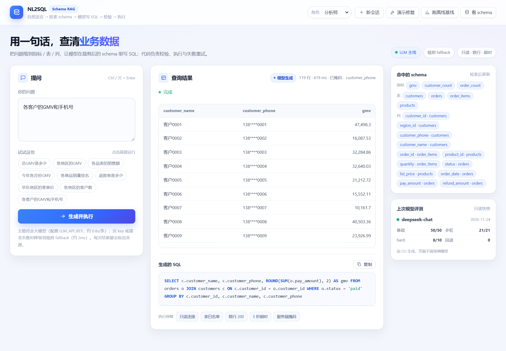

# nl2sql-schema-rag

把自然语言问题映射到「指标 / 表 / 列」，让 LLM 在压缩后的 schema 上生成 SQL；代码负责只读校验、执行、失败重试和权限脱敏。

这是一个可本地运行的 NL2SQL demo：SQLite、标准库、原生 JS，无 LangGraph，无运行时依赖。在线模型是主路径；没配 key 时可以用离线 fallback 跑演示和 CI。



*`analyst` 角色：敏感手机号在结果行上掩码。更多截图见 [docs/screenshots](docs/screenshots/)。*

## 能做什么

- **Schema 检索**：指标 / 表 / 列三路索引，RRF 融合，把候选压到约 3 个指标、12 个列、4–6 张表。
- **语义层**：catalog 里定义指标口径、粒度、可加性、表关系和业务提示；复购问题走专门的 `repurchase_customers` 语义表。
- **LLM 写 SQL**：只把命中的 DDL、指标口径和表关系放进 prompt；生成默认 `temperature=0`。
- **代码兜底**：只读、单语句、表白名单、行数限制、执行超时；失败把数据库报错回传给模型重写，最多 2 次。
- **权限与脱敏**：`analyst` / `viewer` 两角色；隐藏列在检索前就从 catalog 移除，结果行在服务端掩码。
- **多轮追问**：槽位继承 + 自包含改写；「那上个月呢」「改成华南」能接上。
- **分析模式（可选）**：Planner 拆 2–4 步，每步复用单 SQL 链路，Synthesizer 只依据步骤结果写结论。
- **自动结论（可选）**：单 SQL 成功后写 1–3 句结果描述，默认关闭。
- **离线 fallback**：没 key / 模型失败时仍可演示；同时作为 CI 的确定性回归基线。

## 快速开始

要求 Python 3.10+，不需要安装运行时依赖。

```bash
git clone <repo> && cd nl2sql-schema-rag
python scripts/seed_demo_db.py     # 生成 data/demo.sqlite
python main.py                     # http://127.0.0.1:8000
```

要接模型，复制 `.env.example` 为 `.env`，填入 OpenAI 兼容接口的 key：

```ini
LLM_API_KEY=...
LLM_BASE_URL=https://api.deepseek.com/v1
LLM_MODEL=deepseek-chat
```

`main.py` 会自动读取同目录 `.env`。没有 key 也能启动，查询会走 `OfflineFallback`，响应里的 `engine="rule"` 会标明来源。

Docker：

```bash
docker compose up --build     # http://127.0.0.1:8000
docker compose down
```

Compose 只把 8000 绑到 `127.0.0.1`；容器构建时 seed 演示库，并带 `/api/health` 健康检查。

跑测试和评测：

```bash
python -m unittest discover -s tests -v

python -m app.evals                        # 单轮 + 多轮，离线规则基线
python -m app.evals --engine llm           # 单轮 + 多轮，真实模型
python -m app.evals --hard --engine llm    # 规则覆盖外 10 条
python -m app.evals --complex --engine llm # 复杂问法 13 条
python -m app.evals --json                 # CI 用
```

## 架构

```text
问题
  → 角色 / catalog 裁剪
  → 会话 / 槽位继承
  → 意图路由（问数 / 闲聊 / 澄清 / 超纲 / 越权）
  → 指标 / 表 / 列三路检索
  → 压缩后的 DDL + 指标口径 + 表关系
  → LLM 生成 SQL
  → 校验（只读、单语句、表白名单、列白名单、限行）
  → 执行（只读连接、5s 超时）
  → 服务端掩码
  → 结果

失败：数据库报错回传 → 模型重写 → 重新校验（最多 2 次）
没有 key / 模型失败：OfflineFallback（engine="rule"）
```

分析模式是另一条可选路径：

```text
问题 → Planner（2–4 个自包含子问题）
     → 每步复用 ask(mode="single")
     → Synthesizer（只看步骤结果，引用 [sN]）
     → 结论 + 步骤 + evidence
```

## 关键设计

### 1. 先缩小 schema，再让模型写

宽表上直接生成 SQL，常见错误是编字段、接错表、把同名列挂到错误的表上。主路径先做三路检索，只渲染命中的表和列。

- 指标、表、列分别建索引；列以关键词为主，指标/表用稠密 + 关键词，RRF 融合。
- 指标把口径描述一起带进 prompt；表关系（JOIN 键）单独渲染。
- 复购 / 阈值客户问题会加入 `repurchase_customers`；普通客户问题不会。
- 表数软上限 4、硬上限 6；复购 + 多维且没要客户名时，裁掉冗余 `customers`。

### 2. 校验和执行不交给模型

- 只允许单条只读 SQL：`SELECT`，或 `WITH ... SELECT`。
- 表白名单 + 列白名单；`select *` 在存在隐藏列时直接拒绝。
- 执行用只读连接、行数限制和 5 秒语句级超时。
- 生成后做形状检查：筛选条件是否还在 `WHERE`、只换筛选时有没有多 SELECT 筛选列、分组 Top-N 是否有窗口函数、占比题是否真的输出比值列。
- 字段写错不靠 prompt 保证，靠数据库报错兜住；报错回传模型重写，重试仍要重新过校验器。

### 3. 权限在检索之前

角色按请求传，不进会话：

| 角色 | `customer_phone` | 其他列 |
|---|---|---|
| `analyst` | 可见，结果行掩码 | 可见 |
| `viewer` | 完全不可见：不进 catalog / SQL / prompt / 错误信息 | 可见 |

拒绝越权列时不回显列名；`attempts[].sql` 和审计里的隐藏列名会打码。角色是客户端声明的，没有账号体系；这是权限策略演示，不是认证系统。

### 4. 多轮靠槽位继承

顺序是 **会话 → 槽位继承 → 路由 → 生成**。没给指标/维度/筛选/时间时从上一轮继承；换了指标又没指代则开新话题。

会话只在进程内存，默认保留最近 5 轮，最多 200 个会话，重启即清空。

### 5. 分析模式有明确边界

- 最多 4 步；Planner 坏 JSON / 空步骤重试 1 次，仍失败回退单 SQL。
- 每步都复用 `ask(mode="single")`，权限、只读、超时、行数限制一致。
- Synthesizer 不拿 schema、不能写 SQL；没有可用步骤时直接输出「当前结果不足以判断」。
- 总预算默认 60s，单次模型超时 30s，每步 SQL 重试默认 1 次。
- 页面默认关闭，不改变快路径行为。

### 6. 自动结论只描述结果

`conclusion=true` 时，单 SQL 成功后再调一次模型：

- 只依据 `columns/rows` 写 1–3 句，不解释原因，不补没有的数字。
- 空结果 / NULL 直接说空；失败只写 `conclusion_error`，不把 SQL 变成失败。
- 规则 fallback、SQL 失败、空结果不调用。
- 分析模式开启时不叠加，避免两个结论源。
- 默认关闭。

### 7. 离线 fallback 是可靠性组件

没配 `LLM_API_KEY`、模型请求失败、或调用方显式 `use_llm=False` 时，走 `app/fallback.py` 的 `OfflineFallback`：

- 让 demo 和 CI 在没有 key 时也能跑；
- 提供确定性的回归基线；
- 只支持单指标 + 单维度，**不会根据报错改 SQL**；
- 响应里 `engine="rule"` 会明确标出来源。

## 评测

`deepseek-chat`，`temperature=0`，2026-11-25：

| 评测集 | 规则 fallback | LLM |
|---|---|---|
| 基础 50 条问数 | 50/50 | 50/50 |
| 多轮 21 轮 | 21/21 | 21/21 |
| 规则覆盖外 10 条 | 0/10 | 8–9/10（多次采样） |
| 复杂问法 12 条（可判定） | 0/12 | 12/12；最新 3 次 12/12、11/12、12/12 |
| BIRD Mini-Dev fresh 50 题 | — | 官方 EX **36/50（72%）** |

- 单轮意图 57/57，静默回退 0；基础/多轮约 0.7–0.8s/条。
- 288 个单测覆盖检索、校验、修复、路由、多轮、权限、评测、分析模式、自动结论、fallback 和 HTTP 契约。
- hard / complex / BIRD 都是手动评测，不进 CI 门槛；数字是样本，不是能力上下限。
- BIRD 是 fresh 50 题、官方 `set` EX，不是官方 leaderboard；同批题上「数据库描述 + 执行重试」只有 31/50，因此默认关闭。
- 完整评测集说明、hard 用例表、分析模式 A/B 和 BIRD 口径见 [docs/evaluation.md](docs/evaluation.md)。

## 限制

- **demo 只有 6 张表**。检索最多带 4 张，缩表收益有限；真正收敛的是列和指标。换到几十张表的仓库，需要重新验证检索和表关系。
- **按品类/品牌拆分的 GMV 不可直接相加**。`gmv` 是整单 `pay_amount`，join `order_items` 后按维度求和会按明细行重复计入；分组值只能并列展示，不能当可加分摊销售额。
- **分析模式是有界 MVP**。最多 4 步、综合器最多看 50 行；步骤 `ok=true` 只代表 SQL 执行成功，不代表业务口径正确。
- **自动结论不是归因**。它只描述结果，不解释原因，也不能替代多步分析。
- **离线 fallback 覆盖窄**。时间只认固定几类，不支持 IN / HAVING / 季度 / 占比 / 复购 / 任意 Top-N；它只负责兜底和 CI。
- **会话 / 审计在内存**，没有认证、TLS、持久卷；角色由客户端声明，不能直接当生产权限系统。
- **路由和多轮是规则 + 词表**，换说法仍可能误判；没有 LLM 兜底。
- **公开集样本小**。BIRD 50 题有抽样波动，不能因为一次 36/50 就外推成全量。
- 生成默认 `temperature=0`，但模型在 0 下仍可能有服务端采样波动；单次数字不要当稳定基线。

## 目录

```text
app/
  agent.py          主路径：检索、生成、校验、执行、修复、ask()
  analysis.py       分析模式：Planner / Executor / Synthesizer
  conclusion.py     自动结论
  retrieval.py      三路检索 + RRF
  permissions.py    角色裁剪、掩码、审计
  session.py        多轮会话与槽位继承
  catalog.json      演示 schema 与指标口径
  fallback.py       离线规则 fallback
  server.py         HTTP 服务
  web/              原生 JS 页面

eval/               单轮 / 多轮 / hard / complex 用例
benchmarks/         BIRD Mini-Dev 独立评测
docs/               SPEC、评测记录、对比、决策
tests/              288 个单测
scripts/            seed、演示修复、评测快照、截图
```

## 配置

| 变量 | 说明 | 默认 |
|---|---|---|
| `LLM_API_KEY` | 为空时走离线 fallback | 空 |
| `LLM_BASE_URL` | OpenAI 兼容接口 | `https://api.deepseek.com/v1` |
| `LLM_MODEL` | 快路径 SQL 模型 | `deepseek-chat` |
| `ANALYSIS_MODEL` | 分析模式 Planner / Synthesizer 模型；留空复用 `LLM_MODEL` | 空 |
| `ANALYSIS_BASE_URL` | 分析模型独立地址；留空复用 `LLM_BASE_URL` | 空 |
| `ANALYSIS_API_KEY` | 分析模型独立 key；留空复用 `LLM_API_KEY` | 空 |
| `ANALYSIS_TIMEOUT_S` | 分析模式单次模型超时（秒） | 30 |
| `ANALYSIS_TOTAL_BUDGET_S` | 分析模式总预算（秒） | 60 |
| `ANALYSIS_STEP_MAX_REPAIR` | 分析模式每步 SQL 重试次数（0–2） | 1 |
| `PORT` | 服务端口 | 8000 |

模型名以服务商 `/models` 实际返回为准；换模型后要重跑评测。

## 深入阅读

- [docs/SPEC.md](docs/SPEC.md)：需求、验收标准、边界
- [docs/evaluation.md](docs/evaluation.md)：评测集、hard 用例、分析模式 A/B、BIRD 口径
- [docs/comparison.md](docs/comparison.md)：与 DB-GPT / WrenAI / Vanna / nl2sql-agent 等项目的对比
- [docs/decisions.md](docs/decisions.md)：关键设计取舍
- [benchmarks/README.md](benchmarks/README.md)：BIRD Mini-Dev 独立评测的下载与运行

## License

MIT
