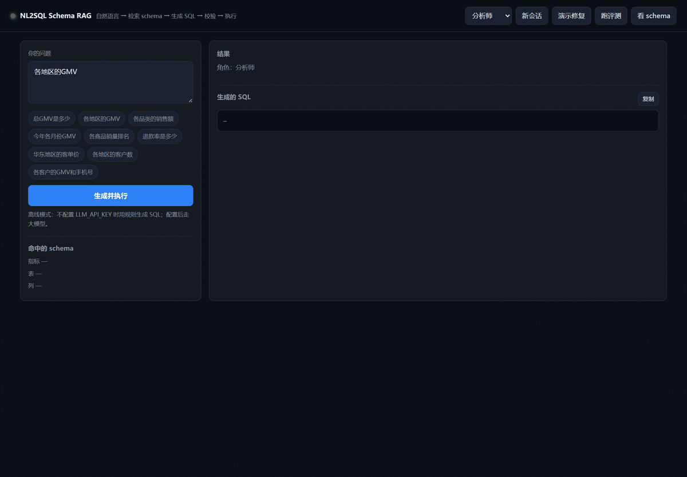

# nl2sql-schema-rag

用自然语言查数据仓库：先把问题映射到「指标 / 表 / 列」，再让**大模型**在缩小的 schema 里写 SQL，最后校验、执行、给出结果。

主路径是 `检索 schema → 模型写 SQL → 代码校验/执行 → 失败带报错重试`。仓库里确实有一套规则模板，
但它已经退到 `app/fallback.py` 的 `OfflineFallback`：只在没配 `LLM_API_KEY`、模型请求失败或显式
`use_llm=False` 时兜底，同时充当 CI 的离线、确定性回归基线。规则和模型差多少、为什么模型不是
可有可无，见「规则 fallback 与模型对比」。

## 为什么写这个

在宽表几十张、字段几百个的仓库上直接让大模型写 SQL，最常见的问题不是"不会写"，是**编字段**：它会把 `pay_amount` 写成 `pay_amt`，把 `order_date` 当成日期类型去 `DATE()`，或者把两张表的同名字段接错。

所以这个项目的重点不是"接个大模型"，而是**把 schema 缩到模型不会犯错的范围内**：

1. 先从问题里抽出业务词（指标、维度、筛选值、时间）；
2. 用三路检索把候选缩到 3 个指标、12 个列（demo 只有 5 张表、检索最多带 4 张，缩表收益有限）；
3. 只把这部分 DDL 放进 prompt；
4. 生成后用代码校验：只读、单语句、表白名单、限行；字段写错由执行报错兜住，并把报错回传给模型重写。

## 它怎么跑

```
问题 → 角色（裁剪 catalog）→ 会话/槽位继承 → 意图路由 → 槽位（指标/维度/筛选/时间）
     → 三路检索 → 裁剪 DDL → 大模型写 SQL → 校验（含列白名单）→ 执行 → 服务端掩码 → 结果
     （失败：把报错拼回 prompt 重写，最多 2 次；没 key / 模型故障才走规则 fallback）
```

- **模型写 SQL**：prompt 里只有命中的 schema（DDL + 指标口径 + 表关系），`temperature=0`，返回 `engine="llm"`。规则模板不在主路径；只有没配 key、请求失败或调用方显式 `use_llm=False` 时才启用 `app/fallback.py` 的 `OfflineFallback`（返回 `engine="rule"`）。
- **权限与脱敏**：角色（`analyst` / `viewer`）按请求传；`viewer` 的 catalog 里没有敏感列，生成器拿不到、prompt 里也没有。掩码在服务端结果行上做，`masked_columns` 会告诉前端哪些列被掩过。
- **多轮**：带 `session_id` 时，先从上文补缺失槽位，再判意图。"那上个月呢""换成华南"能接上；换了指标又没指代算新话题。会话只在内存里，默认留 5 轮。
- **意图路由**：五类意图（问数 / 闲聊 / 缺信息 / 超纲 / 越权），规则优先、可解释。只有"问数"会生成 SQL，其余返回话术或澄清项，不会硬编一条 SQL 出来。只问「有哪些 / 列出」某个维度且已识别到维度时，不需要指标也按问数处理，交给模型写 `SELECT DISTINCT`（例如「华东地区有哪些商品类别」）。
- **三路检索**：指标、表、列分别建索引。列用关键词为主（列名要精确命中），指标和表稠密+关键词各占一半，最后 RRF 融合。
- **裁剪**：只渲染命中的表和列，通常 30 行以内；指标把口径描述一起带上。
- **校验**：只允许单条只读语句（`SELECT`，或 `WITH ... SELECT` 的 CTE）、表白名单、禁 DDL/DML、执行时只读连接 + 限行 + 5 秒语句级超时。CTE 和窗口函数放行（分组 Top-N 需要），DML 仍拒；字段名写错不靠提示词保证，靠数据库报错兜住。
- **自我修复**：失败时把报错拼回 prompt 重写，每次重试都重新过校验器。这是模型路径的能力；规则 fallback 改不了自己的 SQL（不看 `feedback`），重试同一句只会重复同样的错，所以它只负责"仍失败"时别空转。
- **筛选形状检查**：生成后额外检查"上文筛选值还在不在 WHERE 里、只换筛选时有没有多 SELECT 筛选列"；违反时不执行，当作一次 validate 失败，把话术作为 `feedback` 让模型重写。
- **降级**：没配 key / 模型故障时全走规则（离线可跑），返回里的 `engine` 会说明这次是谁生成的。规则的定位和它跟模型的差距见「规则 fallback 与模型对比」。

## 跑起来

本地（零依赖，标准库即可，3.10+）：

```bash
git clone <repo> && cd nl2sql-schema-rag
python scripts/seed_demo_db.py     # 生成演示库 data/demo.sqlite（800 单 / 1608 明细）
python main.py                     # http://127.0.0.1:8000
```

`main.py` 启动时会自动读同目录的 `.env`（没有也能跑）。

Docker（一条命令）：

```bash
docker compose up --build          # http://127.0.0.1:8000
docker compose down
```

镜像基于 `python:3.11-slim`，构建时 seed 演示库；把空目录挂到 `/app/data` 时 entrypoint 会补一次 seed，
自带 `HEALTHCHECK`（打 `/api/health`）。应用本身仍然是零依赖。

Compose 只把 8000 绑到 `127.0.0.1`，避免把无鉴权的 demo / 审计接口暴露到局域网（要局域网演示自己改端口映射）。
要接大模型，照常复制 `.env.example` 为 `.env` 并填 `LLM_API_KEY`：Compose 用宿主 `.env` 做插值、在容器启动时注入，
`.env` 本身已被 `.dockerignore` 排除，不会打进镜像层；也可以 `docker compose run -e LLM_API_KEY=... app`。

想跑评测：

```bash
python -m app.evals                 # 单轮 + 多轮，规则 fallback（CI 默认，离线）
python -m app.evals --engine llm    # 单轮 + 多轮走真实模型（需要 .env 里的 LLM_API_KEY）
python -m app.evals --multi-turn    # 只跑多轮评测
python -m app.evals --hard          # 只跑规则覆盖外的 10 条（默认仍是规则，作对照组）
python -m app.evals --hard --engine llm   # 同一组走真实模型，命令行里能直接对比
python -m app.evals --complex       # 只跑复杂问法 13 条（默认规则，作对照组）
python -m app.evals --complex --engine llm  # 同一组走真实模型（单独统计，不设门槛）
python -m scripts.record_llm_eval   # 跑真实模型评测并写 eval/llm_result.json（页面只读它）
python -m app.evals --json          # 输出 JSON，CI 用
python -m unittest discover -s tests -v
```

## 开发环境

运行时零依赖，Python >= 3.10 都能跑；仓库本身不绑定解释器，推荐用仓库里的 `.venv`（uv 管理）：

| 场景 | 解释器 |
|---|---|
| PyCharm | `.venv`（uv，Python 3.12.13；`.python-version` 固定 3.12） |
| 命令行 | `.venv/Scripts/python`（Windows）或系统 `python`（3.13 也验证过） |
| CI | 3.11 |

`uv.lock` 已提交，`uv sync --extra dev` 可复现开发环境。`dev` extra 只装 Pillow（给 `scripts/shots.py` 合成 GIF），运行时仍然零依赖。

## 现在的结果

**真实模型（`deepseek-chat`，temperature 0，2026-11-24）**：单轮 **50/50**、意图 **57/57**、多轮 **21/21**、静默回退 **0**、平均约 **0.7s/条**（`--engine llm` 单次运行）。同一套检索/校验/权限链路，只把生成器换成模型。

**离线基线（规则 fallback，CI 默认）**：单轮 50/50、多轮 21/21、平均约 2ms——它是确定性的回归网，不是"模型准确率"。250 个单测覆盖检索、生成、校验、修复、路由、多轮、权限、评测、hard/complex/holdout runner、分析模式、自动结论、fallback 拆分、模型快照和 HTTP 契约。

**复杂问法（`--complex`，单独统计）**：13 条里 12 条可判定、1 条归因题标记为未支持；规则 **0/12**，模型 **11/12**（2026-11-24 prompt v3.1 去掉与题面重叠的示例后 3 次均为 11/12，只剩 #13；静默回退 0，平均约 1.1s/条）。归因题当前仍只返回一条取数 SQL，不计通过、只记为局限。

**分析模式 A/B（12 条 complex，2026-11-24 复核重跑）**：prompt v3.1 下 chat **26/26 步、5.98s、coverage 0.71**；flash **25/27 步、16.85s、coverage 0.63**；原始答案 [eval/analysis_ab.json](eval/analysis_ab.json)。旧 8/12、10/12 是单次人工抽样，仅历史；默认仍 chat。

两个模式的分工：

| | 规则 fallback | LLM (`deepseek-chat`) |
|---|---|---|
| 基础 50 条问数 | 50/50 | 50/50 |
| 多轮 21 轮 | 21/21 | 21/21 |
| 规则覆盖外 10 条 | **0/10** | **8–9/10**（多次采样；最近快照 8–9/10） |
| 复杂问法 12 条（可判定） | **0/12** | **11/12**（prompt v3.1 后 3 次一致；只剩 #13；归因题另计未支持） |
| 静默回退 | — | 0 |
| 平均耗时 | ~2ms | ~0.7s（复杂题约 0.9–1.2s） |
| 跑在哪 | CI（离线）、无 key 降级 | 生产主路径、手动评测 |

评测集覆盖 6 个指标 × 6 个维度（31/36 组合，customer 维度只留 1 条连通性用例）、6 类时间过滤，以及 chat / 澄清 / 超纲 / 写操作 / 越权 5 类非问数意图。

---

## 规则 fallback 与模型对比（为什么模型不是可有可无）

`eval/hard_cases.json` 有 10 条**规则覆盖外**的问法，期望 SQL 全部手写、可执行：

| # | 问题 | 规则为什么做不到 |
|---|---|---|
| 1 | 销量最好的三个商品 | 固定 `LIMIT 10/20`，不认"三个" |
| 2 | 华东和华南的GMV对比 | 多值筛选被拼成 `= 华东 AND = 华南`，恒为空集 |
| 3 | 按季度看GMV | 时间维度只有月/年，没有季度推导 |
| 4 | 退款率最高的品类 | 只会分组 + `LIMIT 10`，不会取 Top-1 |
| 5 | 客单价超过7000的品牌 | 没有聚合后过滤（`HAVING`） |
| 6 | 上季度GMV | 时间词只有固定的 6 类，没有自然季度 |
| 7 | 各订单状态的订单数 | 所有指标都焊死 `status='paid'`，状态分布被压成一行 |
| 8 | 最近7天每天的订单数 | 没有滚动 7 天，也不会按天分组 |
| 9 | 各地区销量占全国比例 | 不会窗口/子查询算占比，只会给绝对销量 |
| 10 | 复购客户数 | 只会数去重客户，不会先按客户聚合再 `HAVING` |

实测（`--hard`，同一套链路）：

| 评测集 | 规则 fallback | LLM (deepseek-chat) |
|---|---|---|
| 基础 50 条 | 50/50 | 50/50 |
| 规则覆盖外 10 条 | **0/10** | **8–9/10**（多次采样；最近一批 4 次为 8–9，见 `eval/llm_result.json`） |

模型的失败也照实写：稳定的两条是 **Top-1** 被 prompt 里"排名 → LIMIT 10"带偏成 10 行、
**上季度**被写成"最近三个月"而不是上一个日历季度；「复购客户数」在 4 次里有 1 次把 `GROUP BY`
写在了外层（返回每客户一行）。这组用例**不进 CI 门槛**：规则分天然低，设成门禁只会逼人删规则或
改期望；它的用途是把"规则 vs 模型"的差距写成可复现的数字。

**为什么保留规则**：

- **CI 不配 key**：需要一个离线、确定性的回归网，挡住检索/校验/权限/多轮这些不依赖模型的退化；
- **降级**：没 key、模型超时/失败时服务不能空转，`engine="rule"` 让调用方看得出来；
- **对照组**：没有这组基线，"模型不可替代"就只是一句话。

```bash
python -m app.evals --hard                 # 规则 0/10，平均 2ms
python -m app.evals --hard --engine llm    # 模型 8–9/10，静默回退 0
```

## 复杂问法评测（`--complex`）

`eval/complex_cases.json` 有 13 条复杂问法，专门量 L2（一条复杂 SQL）和 L3（多步分析）的边界：CTE/窗口、分组 Top-N、多指标、占比、复购、多维度，另有 1 条归因题。它**单独统计**，不并入基础 50 / 多轮 / hard，也不作 CI 门槛；expected SQL 全部手写并过 `validate` + `execute`。

```bash
python -m app.evals --complex              # 规则对照组：0/12，约 2ms
python -m app.evals --complex --engine llm # 真实模型：11/12，静默回退 0，约 1.1s/条
python -m scripts.holdout_eval --repeat 3  # prompt v3.1 的 3 条 holdout 泛化检查（不进 CI）
python -m scripts.analysis_ab --models deepseek-chat,deepseek-flash --out eval/analysis_ab.json  # A/B 单次样本，落盘后才能复核
```

实测（`deepseek-chat`，temperature 0，2026-11-24；prompt v3.1 去掉与题面重叠的示例后 3 次 **11/12、11/12、11/12**；唯一失败是 #13，base/hard 未回退）：

| # | 类别 | 问题 | 规则 | 模型 |
|---|---|---|---|---|
| 1 | group_top_n | 华东销售额最高的三个品类，每个品类再列出销售额前两名商品 | ✗ | ✓ |
| 2 | multi_metric | 华东和华南的GMV、退款率对比 | ✗ | ✓ |
| 3 | quarter | 今年各季度的GMV和订单数（季度写成 2026-Q1） | ✗ | ✓ |
| 4 | ratio | 华东各品类销量占华东总销量比例 | ✗ | ✓ |
| 5 | repurchase | 各地区的复购客户数（下过至少两单的客户） | ✗ | ✓ |
| 6 | multi_dim | 各地区各品类的GMV | ✗ | ✓ |
| 7 | unsupported_why | 为什么上个月GMV下降了？ | 未支持 | 未支持 |
| 8 | window | 今年每个月的GMV和环比 | ✗ | ✓ |
| 9 | group_top_n | 每个品牌销售额前两名商品 | ✗ | ✓ |
| 10 | multi_metric | 各品牌的GMV和订单数 | ✗ | ✓ |
| 11 | ratio | 各地区GMV占全国比例 | ✗ | ✓ |
| 12 | multi_dim | 上个月各地区各品类的GMV | ✗ | ✓ |
| 13 | customer_cte | GMV超过3万的客户按地区统计人数 | ✗ | ✗（把地区汇总当客户筛选） |

prompt v3.1 后 3 次 11/12，唯一失败是 #13；没有为了好看改 expected：

- v3.1 **移除了 prompt v3 里与 complex 题面重叠的 4 条示例**（#2/#9/#11 是原题，#3 的季度公式），只保留通用规则：占比题只输出维度+占比列，分组 Top-N 不额外带 ID/中间列，排名指标必须与问题一致（销售额用 `SUM(pay_amount)`，不用 `item_amount`/`quantity`），问题指定格式（如 `2026-Q1`）严格照做。
- v3 的 **12/12 是开发集口径**：示例直接覆盖了 4/12 的题面/公式，不能当泛化成绩。v3.1 去示例后是 **11/12**，说明通用规则仍能过 Q2/Q4/Q9/Q11，分数回落来自去掉泄漏，不是模型退化。
- #2 的 `paid` 口径规则保留：`SUM(pay_amount)` 必须 `WHERE status='paid'` 或 `CASE WHEN paid`；v3.1 删掉 Q2 整题示例后 Q2 仍通过。
- #13 仍失败：模型把“地区 GMV 汇总 > 3 万”当成“客户 GMV > 3 万”再数人，返回 52 行客户明细；这是语义/粒度问题，不是 shape，留作已知失败。
- 分析模式里 #5 的“地区级 HAVING”现在由代码判为步骤不可用（见分析模式），不会再把它当复购客户数引用；#13 仍未修。

**Holdout 泛化验证（2026-11-24）**：另写 3 条没进 prompt 示例的变体（地区品牌 Top-2 / 品牌销量占比 / 退款率最低 Top-3），[scripts/holdout_eval.py](scripts/holdout_eval.py) 跑 3 次，LLM **3/3、3/3、3/3**；规则对照组 **0/3**。它不进 CI、不并入 complex，只用来检查 v3.1 是否只会那 12 条。3/3 不能证明泛化，但至少没有“示例一换就崩”。

**归因题是已知局限**：`expected_unsupported: true` 的问题没有 `expected_sql`，只记录系统实际响应，**不算通过也不算 SQL 失败**。当前它仍会被路由成问数并返回一条"上个月 GMV"，没有对比和归因；这条要等分析模式（多条 SQL + 综合结论）才可能真正回答。`complex_unsupported_answered` 如实记录为 1/1。

一个口径说明：`gmv` 按 catalog 定义是整单金额 `SUM(orders.pay_amount)`。按品类/商品/品牌拆分时（#1/#6/#9/#10/#12）沿用基础集写法，join `order_items` 后整单金额会按明细行重复计入——所以这些分组 GMV **不可跨组相加**，也不等于可加的分摊销售额（全国 paid GMV 3,362,703.71，按品类相加会到 7,877,829.48）。需要可加口径时应另加明细金额指标（`SUM(order_items.item_amount)`），不能直接把 `gmv` 换掉；#4 的占比因此改用可加的销量，而不是销售额。

## 分析模式（Step 2 MVP，可选，默认关闭）

页面和接口默认仍走单 SQL 快路径；只有显式 `mode="analysis"`（页面「分析模式」开关，默认关）才进入有界 plan-and-execute：

```
问题 → Planner（2–4 个自包含子问题，只输出 JSON，不看 schema）
     → Executor（每步复用 ask(mode="single")，同 role、不共享 session，校验/权限/只读/超时不变）
     → Synthesizer（只看步骤结果，不给 schema、不能再写 SQL；结论必须引用 [sN]）
     → 结论 + 步骤 + evidence
```

- 最多 4 步；Planner 坏 JSON / 空步骤重试 1 次，仍失败回退单 SQL，并在 `analysis_error` 说明，页面显示"分析模式未执行"。
- 某步澄清 / 越权 / 超预算 → `skipped`，不硬跑；失败的步骤原样返回，不隐藏。
- Synthesizer 没有可用步骤时不调模型，直接输出"当前结果不足以判断"；模型漏写失败步骤时由代码补"局限"。
- **步骤聚合层级检查**：复购类子问题如果把 `HAVING` 放在地区分组上（`GROUP BY region HAVING COUNT(order_id)>=2`），返回的是该地区全部客户；代码直接判该步不可用，结论只能说“不足以判断”，不会再引用错数。
- 总预算 `ANALYSIS_TOTAL_BUDGET_S`（默认 60s，从 Planner 开始计时；耗尽后不再调综合模型）和单次模型超时 `ANALYSIS_TIMEOUT_S`（默认 30s）可配；每步 SQL 重试 `ANALYSIS_STEP_MAX_REPAIR`（默认 1，范围 0–2，低于快路径的 2 次）；每步 SQL 仍受 5s 执行超时保护。
- Planner/Synthesizer 用 `ANALYSIS_MODEL`（默认同 `LLM_MODEL`）；SQL 生成仍用 `LLM_MODEL`。接千问等另一家 OpenAI 兼容服务时配 `ANALYSIS_BASE_URL` / `ANALYSIS_API_KEY`（留空则复用 LLM 的地址/key）。reasoning 模型不传 `temperature`。

```bash
curl -s localhost:8000/api/ask \
  -d '{"question":"华东和华南的GMV、退款率对比","mode":"analysis"}'
```

响应在快路径字段之外增加 `mode / steps / answer / evidence`；每个 step 带 `question / purpose / sql / columns / rows / row_count / ok / skipped / error / engine / elapsed_ms`。分析步骤的表格 UI 只渲染前 20 行，综合器最多看 50 行（超过时 prompt 会标注"未展示行不能用于排名/汇总推断"）。

### A/B：deepseek-chat vs deepseek-flash

下面 3 条是 **prompt v1** 的样本，保留作对比；Q2 的 paid 问题已在 prompt v2 修复，12 条全量见下一节。

供应商 `/models` 当前只返回 `deepseek-flash` / `deepseek-v4-pro`；`deepseek-reasoner` 已不在列表，实测请求仍返回 200，但响应里的 `model` 是 `deepseek-flash`——之前标成 reasoner 的那轮其实就是 flash，文档按实际模型改写。

同一套 prompt、同样 3 条 complex 题（分组 Top-N / 多指标对比 / 月度环比），各跑一次；`deepseek-chat` 用 temperature 0，flash 不传 temperature：

| 指标 | deepseek-chat | deepseek-flash |
|---|---|---|
| 结论质量（人工） | 3/3 有可用结论；Q2 明说“两退款率口径不一致，不能判断” | 2/3 可用；Q2 把未过滤 `paid` 的 GMV（886055.23 / 939303.72）当完整数据，未标注 |
| 步骤成功 | 6/6 | 6/6 |
| 平均耗时 | **4.5s** | **9.4s**（约 2.1×） |
| prompt tokens | 2,874 | 3,024 |
| completion tokens | 1,145 | 4,253（约 3.7×） |
| 假因果 / 未标注错数 | 0（Q2 明说不可比） | **1**（Q2 的 GMV 错数未标注） |

结论：**不换默认模型**。flash 在月度环比题上更完整，但更慢，且这轮 Q2 产出了未标注的错数；同一条 Q2 换一次运行结果又不同（另一轮 flash 把退款率算成 0.0 但主动标注了口径不一致），说明小样本波动大。下一步应扩到 complex 全集、固定题集多次采样再决策。

补充：两列都**只替换 Planner/Synthesizer**，每条 SQL 仍由 `LLM_MODEL=deepseek-chat` 生成——这是分析模式端到端，不是快路径单 SQL。`deepseek-v4-pro` 也试了 2 题（同样只做 Planner/Synthesizer，超时放宽到 180s）：Q1 18.6s、结论正确；Q2 73s、10,217 completion tokens，仍没给出完整月度环比（还把去年 12 月写成 2024-12）。按 30s 预算 Q2 会先超时，暂不适合做默认分析模型。

千问实测（DashScope OpenAI 兼容，2026-11-24，同一 3 题，SQL 仍 chat；代码已支持单独 `ANALYSIS_BASE_URL` / `ANALYSIS_API_KEY`）：

| 分析模型 | 结论质量 | 步骤 | 平均耗时 | prompt / completion tokens |
|---|---|---|---|---|
| `qwen3.8-flash` | **3/3**；Q2 明说退款率口径不可比 | 6/6 | **40.5s** | 3,727 / 7,935 |
| `qwen3.7-flash` | **2/3**；Q2 把未过滤 `paid` 的 GMV（886055/939303）当完整数据，未标注 | 6/6 | **50.4s** | 3,087 / 15,972 |

`qwen3.8-flash` 是唯一做到 3/3 且没有未标注错数的非 chat 模型，但平均 40.5s、Q2 单题 55s；默认单次 30s 超时会失败，只能作为“愿意等”的可选深分析（`ANALYSIS_TIMEOUT_S` 至少 120、总预算 180–300），不能做默认。`qwen3.7-flash` 更慢且 Q2 错数未标注，不采用。

### 12 条全量（Planner/Synthesizer 换模型，SQL 仍 chat）

2026-11-24 把 A/B 从 3 条扩到 12 条可判定 complex，每种分析模型跑一遍，人工按“结论完整且无错数”分类；SQL 一律由 `deepseek-chat` 生成（prompt v3）。

> **审核更正（2026-11-24）**：这是 **prompt v3（含与 complex 题面重叠的示例）的单次人工抽样**，且没有落盘原始答案。独立复跑发现 chat 的 **#5 曾把全部付费客户当成复购客户**（错数，28/33/27/31 vs 正确的 27/32/26/30），所以“有错数 0”不成立；步骤成功数也出现过 25/26。下表仅作历史记录，不再作为当前质量结论。

| 指标 | `deepseek-chat` | `deepseek-flash` |
|---|---|---|
| 完整正确 | **8/12**（当次抽样） | **10/12**（当次抽样） |
| 有错数 | **0（当次抽样；复跑发现 #5 错数）** | 0（当次抽样，未复跑） |
| 部分/未完成 | 4（#5 复跑会错或说不够；#13 不够；#6/#12 只给部分值） | 2（#5/#13 不够） |
| 步骤成功 | **26/26**（当次；复跑有一轮 25/26） | 23/24（#5 一步 clarify skipped） |
| 平均耗时 | **5.9s** | **15.3s**（2.6×） |
| prompt / completion tokens | 12,884 / **4,976** | 13,700 / **25,394**（5.1×） |
| 自动覆盖率（只作信号） | 0.72 | 0.85 |

当时的结论：prompt v3 后 flash 不再有 #9 的 `item_amount` 错数，并多完成了 #6/#12 的全量列表，达到 10/12；但延迟 2.6×、completion 5.1×，#5/#13 两边都还答不出。这个结论受单次抽样/示例泄漏限制，**只作历史**。

### 复核重跑（2026-11-24，prompt v3.1）

原始答案已落盘：[eval/analysis_ab.json](eval/analysis_ab.json)（逐题 answer + step SQL，48KB，无 key）。这轮只记录 raw 指标，不再把单次人工“完整/错数”分类当稳定基线：

| 指标 | `deepseek-chat` | `deepseek-flash` |
|---|---|---|
| 步骤成功 | **26/26** | 25/27（#5 两步 skipped） |
| 平均耗时 | **5.98s** | 16.85s |
| prompt / completion tokens | 13,668 / **5,031** | 14,187 / **25,693** |
| 自动覆盖率（只作信号） | 0.71 | 0.63 |

从原始答案看 chat 仍更稳：C5/C13 两边都说“不够”，C6/C12 chat 只给部分值；flash 的 C8 把环比算成绝对差额、C10 的 GMV 被判口径不可用，也没有更好。**默认仍 chat**；要再做质量结论，需要先固定一套人工 rubric、多次采样，而不是看单轮 coverage。

**Q2 的提示词约束有效**：在 SQL prompt 里明确“`SUM(pay_amount)` 必须 `WHERE status='paid'` 或用 `CASE WHEN paid`”；v3.1 删除了 Q2 的整题示例，只保留 paid 规则和多指标形状规则，Q2 单 SQL 仍通过。另加确定性兜底：`_sql_warning` 标出未过滤 `paid` 的 GMV，`_repurchase_aggregation_error` 标出复购题的 HAVING 层级错误；即使综合器漏看也不会静默。这样提示词负责“尽量写对”，代码负责“错了必须标出来/不可用”。

A/B 第一轮暴露了两个真实问题，修复后才有上表（当时 `deepseek-reasoner` 别名实际由 flash 响应）：

1. 分组 Top-N 只给综合器 20 行预览，漏了 24 行里的目标商品，结论算错 → 综合器预览调到 50 行，并在 prompt 标注“截断后不能用于排名/汇总推断”；UI 仍只渲染 20 行。
2. Planner 把“退款率（退款金额/订单金额或退款订单数/订单数）”写进子问题，SQL 生成选了金额口径 → Planner prompt 明确“不要写 SQL、公式或指标口径”，由执行器按 catalog 定义生成。

已知局限：Planner 仍可能拆错（#5 复购/#13 客户阈值这类“先按客户聚合再按地区计数”经常拆错）；#5 的地区级 HAVING 现在由代码判为步骤不可用，结论会说不够，不再引用错数；#13 仍可能把客户明细/地区汇总搞错，且客户明细 119 行超过综合器 50 行预览；chat 在 #6/#12 只给部分值（数据对，但没列全）。50 行预览之外仍可能漏数据；分析结论不能把分组 GMV 当可加事实，也不能当因果证据。千问只在 3 条上测过（3/3 但 40.5s），12 条全量因 key 到期未跑，不据此换默认。

## 自动结论（Step 3，可选，默认关闭）

单 SQL 成功后，显式传 `conclusion=true`（页面「自动结论」开关）会多调用一次 `LLM_MODEL`，只依据返回的 columns/rows 写 1–3 句中文结论：

- 只陈述结果，**不解释原因**；没有的数字不补；结果为空/NULL 直接说空，不说“因为”；
- 不给 schema、不允许写 SQL；结论失败只写 `conclusion_error`，**不把已经成功的 SQL 变成失败**；
- 规则 fallback、SQL 失败、空结果都不调用模型；
- 最多展示 50 行给结论模型，超出会标注截断，不能用未展示行做排名/汇总。

```bash
curl -s localhost:8000/api/ask \
  -d '{"question":"各地区的GMV","conclusion":true}'
```

响应在快路径字段外增加 `answer / conclusion / conclusion_error / conclusion_usage`。实测 `deepseek-chat`：`各地区的GMV` 约 **1.7s**，结论正确；`整体客单价` 约 **1.2s**；`去年全年的GMV` 返回 NULL 时结论是“结果为空（NULL）”，没有编原因。相比纯 SQL 的 ~0.8s，多约 0.5–0.9s；页面默认关闭，不改变快路径行为。

## 页面长什么样

每条结果都会标出来源：**模型生成**（主路径）、**规则 fallback**（没 key / 请求失败时的降级）、**固定 SQL 演示**（「演示修复」按钮，两条 SQL 写死，不调模型）；右上角「**跑离线基线**」跑的是离线规则基线（约 2ms，CI 用），页面不会现场调模型。配置过模型评测后，左栏会多一条「上次模型评测」，数字来自只读快照 `eval/llm_result.json`，没有就隐藏。

界面是浅色工作台：左侧提问、中间结果、右侧 schema / 模型快照；提问区有「分析模式」「自动结论」两个开关，默认都关闭，开启分析模式时自动结论禁用；窄屏自动堆叠。

**analyst：手机号在结果行上掩码**（点图看原尺寸）

[](docs/screenshots/01-role-mask-analyst.png)

**viewer：同一句直接判越权，不生成 SQL**

[](docs/screenshots/02-role-mask-viewer.png)

**演示修复：固定 SQL 复现"写错列名 → 带报错改对"（演示，不代表模型能力）**

[](docs/screenshots/03-demo-repair.png)

多轮承接 + "改成华南"（GIF，约 9 秒）：



素材由 `python scripts/shots.py` 用无头 Chrome 固定生成（3 张 PNG + 1 个 GIF）；页面改了重跑一次即可，
不用手工对时间点。脚本是开发工具，只额外需要 Pillow 合成 GIF。

## 自我修复（M1）

生成 → 校验 → 执行，任何一步失败都会把报错拼回 prompt 重写，最多 `max_repair` 次（默认 2）；**每次重试都要重新过校验器**，不会靠"重试"绕过只读检查。

- 返回契约：`ok=true` 时 `error` 为空、`failure_stage` 为空；`ok=false` 时 `error` 是最后一次的报错，`attempts` 记录全部尝试（每次含 `n / sql / ok / error / stage`，`stage` 为 `validate / execute / timeout / ok`）。
- 真实路径：配 `LLM_API_KEY`，模型看到 `no such column: order_cnt` 后改写；
- 可复现演示：`python -m scripts.demo_repair`（脚本化生成器，离线，一条命令看到两次尝试）；
- 超时保护：单条 SQL 超过 5 秒由 sqlite 的 progress handler 中断，记 `执行失败：查询超时（>5 秒），已中断`，并且**不会重试同一句**；
- 页面上会显示"自我修复：共尝试 N 次"和每次的报错；没配 key 时点右上角「演示修复」，走 `/api/demo/repair` 的脚本化生成器，离线也能看到完整的两次尝试。

规则 fallback 不看 `feedback`，所以**离线模式不会真的改 SQL**——这一点在「已知问题」里写清楚了。

## 多轮追问（M3）

带 `session_id` 才接上文；不带就是单轮，行为与 M2 一致。页面会自动带上，右上角「新会话」可以清空上下文。

顺序是 **会话 → 槽位继承 → 路由 → 生成**，不能反过来：`那上个月呢` 字面上没有指标，先路由会被 M2 判成"需要澄清"，多轮就断在第二轮。所以 `classify(question, catalog, slots)` 只接收算好的槽位，不自己再抽一遍。

继承规则都写在 `app/session.py`，可解释：

| 槽位 | 规则 |
|---|---|
| 指标 | 同一个指标接着说、带指代（那/呢/换成…）、或者只补槽位（"上个月""按品类看下"）才继承；换了指标又没指代、或句子里有新主语（"上个月工资…"）→ 开新话题 |
| 维度 | 没给就继承，给了就覆盖；说"总/整体"且没有"各/按"时，视为显式要求不分组 |
| 筛选 | 按类型覆盖："换成华南"只换地区，上文按品类的筛选还在 |
| 时间 | 没给就继承，给了就覆盖 |

改写后的问句会补一句"（承接上文：GMV、各地区）"，作为生成器的输入，规则和 LLM 看到的是同一个自包含问题；接口也返回 `rewritten_question` 和 `inherited_slots`，页面上会显示这一行。

```bash
# 第一句：拿到 session_id
curl -s localhost:8000/api/ask -d '{"question":"各地区的GMV"}'
# 第二句：带回去就接上文
curl -s localhost:8000/api/ask -d '{"question":"那上个月呢","session_id":"<上一步的 id>"}'
```

会话不落盘（进程内存，重启即清空），每个会话默认留最近 5 轮，会话数也有上限。

## 权限与脱敏（M4）

角色按请求传，不进会话：`{"question": "...", "role": "viewer"}`，页面右上角可以切换。顺序是 **role → 按角色裁剪 catalog → 会话槽位 → 路由 → 检索/生成**——列过滤必须在检索之前，否则隐藏列会进 context 和 prompt。

| 角色 | 敏感列（`customer_phone`） | 普通列 |
|---|---|---|
| `analyst` | 可见，但结果行由服务端掩码成 `138****0047` | 全部可见 |
| `viewer` | 完全不可见：不进 catalog、不进 SQL、不进 prompt、不进错误信息 | 全部可见 |

泄漏路径都堵住了（AC-4.1）：

1. **生成的 SQL**：校验器加了列白名单（`validate(sql, catalog, denied=...)`），命中隐藏列直接拒绝；
2. **`select *`**：`*` 不含列名、白名单匹配不到，所以 `denied` 非空时直接禁止 `select *` 和 `表.*`（`count(*)` 不受影响）；
3. **错误信息**：拒绝话术是"引用了无权访问的列"，不回显列名——否则错误本身就成了泄漏通道；
4. **`attempts[].sql` 与审计**：隐藏列名统一打码成 `***`，前端/日志/审计里都看不到。

请求无权列时返回 `unsafe` + 说明（AC-4.2），不静默把列删掉；掩码只在结果行上做，不写进 SQL（AC-4.3）。掩码列只允许**裸列投影**——改名、函数包裹、拼接都会让结果列名变掉从而绕过按列名的掩码，校验阶段直接拒；结果行上还有一层"11 位手机号"值模式兜底。越权请求和"模型自己写了隐藏列"都会进审计（AC-4.4）：

```bash
# analyst：返回掩码手机号，masked_columns 里点明
curl -s localhost:8000/api/ask -d '{"question":"各客户的GMV和手机号","role":"analyst"}'
# viewer：同一条问题直接 unsafe
curl -s localhost:8000/api/ask -d '{"question":"各客户的GMV和手机号","role":"viewer"}'
# 审计与按角色裁剪的 schema
curl -s localhost:8000/api/audit
curl -s 'localhost:8000/api/schema?role=viewer'
```

角色策略在 `app/permissions.py`：配"隐藏列 + 掩码列"，敏感列默认隐藏（新加敏感列不配置就不可见，等于最小权限白名单），不是把全部可见列枚举一遍。

## 评测与 CI（M5）

评测分四组，**指标不混算**（混在一起历史数字就不可比了）。

**单轮 57 条**（`eval/cases.json`，50 条问数 + 7 条意图/越权）：主指标是"两边都执行、比对结果集"，SQL 字面匹配只作参考。

| 覆盖 | 现状 |
|---|---|
| 指标 | 6 个指标全部出现 |
| 维度 | 6 个维度全部出现 |
| 指标×维度 | 31/36（customer 维度按客户分组每行 count=1，只留 1 条连通性用例） |
| 时间 | 6 类：上个月 / 本月 / 今年 / 去年 / 最近 30 天 / 指定月份（`month:YYYY-MM`） |
| 意图 | chat ×2 / 超纲 ×2 / clarify ×1 / 写操作 unsafe ×1 / viewer 越权 ×1 |
| 其它 | 地区/品类筛选、双筛选、同义说法（成交额 / 平均订单金额）、Top N |

**多轮 21 轮**（`eval/multi_turn.json`，7 个会话 × 3 轮）：用同一个 `Session` 顺序跑，覆盖时间继承、维度覆盖、筛选切换、"总共"不分组、新话题不继承、澄清轮不污染上下文、**客户维度回环**和**"改成华南"改写**；`multi_turn_rate` 单独统计。

**规则覆盖外 10 条**（`eval/hard_cases.json`）：IN 多值筛选 / 季度 / HAVING / 任意 Top-N / 占比 / 复购 / 状态分布 / 滚动 7 天。`--hard` 单独输出 `hard_total / hard_match / hard_rate / hard_engine_counts`，**不并入**单轮与多轮；它只作"规则 vs 模型"的证据，不作 CI 门槛。用例自检也进了单测：期望 SQL 必须过校验/执行，且每条都必须路由到 `ask`（被澄清/超纲拦掉就测不到生成）。

**复杂问法 13 条**（`eval/complex_cases.json`）：CTE/窗口、分组 Top-N、多指标、占比、复购、多维度，覆盖见上一节。`--complex` 单独输出 `complex_total / complex_supported / complex_match / complex_rate / complex_unsupported / complex_failure_counts`，**不并入**其它三组，也不作 CI 门槛。归因题标 `expected_unsupported`，只记录系统实际响应，不算通过也不算 SQL 失败；用例自检同样进了单测。

同类项目的定位、能力边界和评测口径差异见 [docs/comparison.md](docs/comparison.md)（DB-GPT / WrenAI / Chat2DB / SuperSonic / Vanna / nl2sql-agent）。

**失败分类**：失败用例带 `failure` 字段，`summary.failure_counts` / `multi_turn_failure_counts` 分别汇总——`routed`（路由拦截）/ `permission`（权限）/ `validate`（校验）/ `field`（字段不存在）/ `syntax`（生成语法错）/ `timeout`（超时）/ `retrieval`（检索未命中）/ `result`（结果不一致）/ `intent`（意图不符）。分类先看 `ask()` 记录的 `attempts[].stage`；只有执行阶段再按错误码区分 `field` / `syntax`（`no such column` / `syntax error`）。

**真实模型模式**（需要 `LLM_API_KEY`）：

```bash
python -m app.evals --engine llm
```

`2026-11-24`、`deepseek-chat`、temperature 0：**单轮 50/50、意图 57/57、多轮 21/21、hard 8–9/10（多次采样；最近快照 8–9/10）、complex 11/12（prompt v3.1，3 次一致）、静默回退 0、平均约 0.8s/条**。每条 details 都带 `engine`；`engine=rule` 表示请求失败退回了规则——这种情况 `main()` 直接退出码 1，避免把"LLM 100%"实际上是规则跑出来的成绩当真。CI 默认仍用 rule（离线、确定性）跑基础集，LLM 与 `--hard` 是手动步骤。

阈值：SPEC 门槛 85%，CI 按 90% 卡；意图命中率、多轮一致率同为 90%。CI 跑单测 + 评测（`timeout-minutes: 10`），评测 JSON 作为 artifact 上传，失败时能直接看哪条挂了。

```bash
python -m app.evals --threshold 0.9 --min-intent 0.9 --min-multi 0.9 --json
```

### 页面评测 vs 模型评测

页面按钮叫「**跑离线基线**」，只跑 `engine=rule` 的离线规则集：57 条单轮 + 21 轮多轮，约 2ms，和 CI 是同一套。它不调模型、不落盘，结果提示里会写 `engine=rule`。

| | 页面「跑离线基线」 | 模型评测（CLI） |
|---|---|---|
| 触发 | 点按钮 / `GET /api/eval` | `python -m app.evals --engine llm` |
| 生成器 | 规则 fallback（离线） | `deepseek-chat` |
| 范围 | 57 单轮 + 21 多轮 | 同左；hard 另跑 `--hard --engine llm` |
| 耗时 | ~2ms | ~1 分钟 |
| 确定性 | 完全确定 | 温度 0 仍有采样波动 |
| 用途 | CI 回归、离线演示 | 发布前手动跑、能力证据 |
| 结果 | 不落盘 | 写 `eval/llm_result.json`（只读快照） |

**为什么不在页面点一次跑一次模型**：一次模型评测要 70 次生成请求（50 条单轮问数 + 20 轮多轮问数；7 条意图/澄清不生成 SQL），约 1 分钟、有成本，而且温度 0 也仍有采样波动；挂在按钮上既慢又不可重复。同类项目也都把模型评测放在 CLI/脚本里，页面只做交互查询。

页面读最近一次快照：`GET /api/eval/llm/last` → `eval/llm_result.json`；有就显示「上次模型评测：deepseek-chat · 2026-11-24 · 基础 50/50 · 多轮 21/21 · hard 8–9/10 · 回退 0」，没有（或文件坏了）就隐藏。快照由脚本生成：

```bash
python -m scripts.record_llm_eval                 # 基础 + 多轮 + hard × 4（约 2 分钟）
python -m scripts.record_llm_eval --hard-runs 2   # 少跑几次 hard
```

脚本只从 `run()` / `run_hard()` 的汇总里取字段，`details` / `multi_turn_details` 全部丢掉；静默回退 >0 或 hard 期望 SQL 自身报错时直接失败、不写文件。artifact 里只有模型名、日期和汇总，没有任何 key。页面加载和单测都只读这个文件，不会触发模型调用。

## 公开 benchmark（BIRD / Spider）：现在只做评估，不接

**结论：不接。** 现有的 hard 组已经回答了"模型是不是可有可无"（规则 0/10 vs 模型 8–9/10）；公开集是外部有效性的加分项，不是前置条件。仓库里**没有任何 BIRD/Spider 分数**，也不准备在没有真跑过的情况下写一个。

如果以后要接，工作量不是"半天"：

| 数据集 | 形态 | 建议抽样 | 粗估 |
|---|---|---|---|
| Spider 1.0 dev | 1034 题，SQLite，schema 简单 | 100–200 题 | ~1 天 |
| BIRD mini-dev | 真实脏数据 + evidence，难度更高 | 100–200 题 | ~1–1.5 天 |
| DuSQL | 中文原生；官方只有 schema/content JSON，要自己建 201 个库、修 gold SQL | 100–200 题 | ~1–2 天 |

接的话必须遵守（否则分数不可信）：

1. **独立 `benchmarks/`**：不并进 `app/evals.py` 的题库，也不进 CI；benchmark 是手动/夜间任务。
2. **通用 schema 模式**：只给表/列/外键，不给 `catalog.json` 里的业务指标口径和 `METRIC_SQL`；否则 prompt 会拿业务定义去套公开库。
3. **关掉自动 `LIMIT`**：产品里的 `execute(max_rows=200)` 和期望 SQL 的 `LIMIT 200` 会截断 gold 结果，benchmark 要直连只读连接执行。
4. **严格 / 宽松两种 EX 都报**（本项目的两种口径）：严格 = 列数一致 + 行集合一致；宽松 = 忽略列顺序/列选择差异，只比对是否覆盖 gold 行。只报严格会低估，只报宽松会虚高。
5. **打乱题目**：有些集按模板排序，取前 N 条会虚高（有项目实测过 70% → 40% 的差距）；固定 seed 并写进报告。
6. **不要用测试题调 prompt 后再报同一批题**，留一部分不看；公开集通常明显低于自建集，这很正常，把限制写清楚。

**不并进 CI**：CI 只跑离线规则回归（`--engine rule`，10 分钟超时），公开集是手动/夜间任务。

## 配置

不配也能跑。要接大模型，复制 `.env.example` 改名 `.env`（`main.py` 会自己读，不用 `export`）：

| 变量 | 说明 | 默认 |
|---|---|---|
| `LLM_API_KEY` | 为空则走规则 fallback（离线可跑） | 空 |
| `LLM_BASE_URL` | OpenAI 兼容接口 | `https://api.deepseek.com/v1` |
| `LLM_MODEL` | 快路径 SQL 生成模型 | `deepseek-chat` |
| `ANALYSIS_MODEL` | 分析模式 Planner/Synthesizer 模型；留空则同 `LLM_MODEL` | 空 |
| `ANALYSIS_BASE_URL` | 分析模型另一家 OpenAI 兼容地址（如千问）；留空复用 `LLM_BASE_URL` | 空 |
| `ANALYSIS_API_KEY` | 分析模型另一家的 key；留空复用 `LLM_API_KEY`；不要提交 | 空 |
| `ANALYSIS_TIMEOUT_S` | 分析模式单次模型调用超时（秒） | 30 |
| `ANALYSIS_TOTAL_BUDGET_S` | 分析模式总预算（秒，从 Planner 开始计时；耗尽后不再调综合模型） | 60 |
| `ANALYSIS_STEP_MAX_REPAIR` | 分析模式每步 SQL 最大重试次数（0–2，低于快路径的 2） | 1 |
| `PORT` | 服务端口 | 8000 |

> 模型名以服务商 `GET {LLM_BASE_URL}/models` 实际返回为准，不要凭版本号猜。本项目实测 `deepseek-chat`（快、稳）；
> 换模型后要重跑评测并重录 `eval/llm_result.json`；`engine=rule` 表示请求失败静默回退，这轮结果不可信。
> 2026-11-24 实测 `deepseek-flash` 能出正确结果但复杂题约 15s，`deepseek-v4-pro` 在 30s 超时后回退，
> `deepseek-V4.1-flash-1017` 被当前 endpoint 以 400 拒绝（不是代码限制）。

数据库、向量库这些没有做成必填：演示库是 SQLite，检索是内存索引。真接 Qdrant/ES 时替换 `app/retrieval.py` 里的 `DenseIndex` 即可。

## 目录

```
app/
  catalog.json      演示 schema（5 表 + 6 指标，customers.customer_phone 标 sensitive）
  catalog.py        加载成领域对象
  domain.py         表/列/指标/命中/计划的定义
  slots.py          业务词槽位（指标/维度/筛选/时间）——全项目唯一的词表
  retrieval.py      三路检索 + RRF
  router.py         意图路由（五类，规则优先；槽位由调用方传入）
  session.py        多轮会话与槽位继承（保留最近 5 轮，进程内存）
  permissions.py    角色策略、catalog 裁剪、掩码、SQL 打码、审计（M4）
  agent.py          主路径：LLM 生成、校验、执行、带报错重试、ask()；mode=analysis / conclusion 入口
  analysis.py       分析模式：Planner / Executor / Synthesizer（有界、每步复用 ask）
  conclusion.py     Step 3 自动结论：只依据 columns/rows 写 1–3 句，默认关闭
  fallback.py       规则模板（离线降级 + CI 确定性基线，不是主路径）
  demo.py           离线演示修复用的固定 SQL（M6）
  evals.py          评测（单轮执行一致 / 多轮 / hard / complex / 失败分类 / 模型快照路径）
  env.py            .env 读取（标准库实现）
  server.py         HTTP 服务（含 mode=analysis、只读 /api/eval/llm/last）
  web/              问数页面（原生 JS，无构建；含默认关闭的分析模式开关）
Dockerfile          容器镜像（python:3.11-slim，构建时 seed）
docker-compose.yml  一条命令启动
uv.lock / .python-version  开发环境锁定（uv，运行不需要）
eval/cases.json     57 条单轮（50 问数 + 7 意图/越权）
eval/multi_turn.json 7 个会话 × 3 轮多轮对照
eval/hard_cases.json 规则覆盖外 10 条（`--hard`，规则 vs 模型的证据）
eval/complex_cases.json 复杂问法 13 条（`--complex`，CTE/窗口/多指标/占比/复购，1 条归因题标记未支持）
eval/holdout_cases.json prompt v3.1 的 3 条 holdout（手动验证泛化，不进 CI）
eval/analysis_ab.json 分析模式 12 条 A/B 的原始答案/SQL（prompt v3.1，人工复核用；不含 key）
eval/llm_result.json 最近一次模型评测的只读快照（页面只读它，不含 key/明细）
scripts/seed_demo_db.py
scripts/demo_repair.py  演示"写错列名 → 带报错改对"
scripts/record_llm_eval.py  跑真实模型评测并写 eval/llm_result.json（不进页面/CI）
scripts/analysis_ab.py  分析模式 12 条 A/B（单次人工抽样；`--out` 落盘；只换 Planner/Synthesizer，SQL 仍 chat；不写快照、不进 CI）
scripts/holdout_eval.py  prompt v3.1 的 3 条 holdout 泛化检查（不进 CI、不设门槛）
scripts/shots.py    固定截图脚本（无头 Chrome + GIF）
docs/screenshots/   3 张截图 + 多轮 GIF
tests/              250 个单测（含 hard/complex/holdout、分析模式、自动结论、模型快照、HTTP 契约）
docs/decisions.md   几个取舍的记录
docs/comparison.md  同类 NL2SQL 项目对比与复杂问题边界
```

## 已知问题

- **规则 fallback 只支持单指标 + 单维度**（FIXME 在 `app/fallback.py`）。「各品牌客单价和销量对比」会退化；模型路径没有这个限制，但这组评测仍以单指标为主。
- **规则 fallback 覆盖窄**（这正是它只配做 fallback 的原因）：时间只认上个月/本月/今年/去年/最近 30 天/具体月份；IN、HAVING、季度、占比、复购、任意 Top-N、状态分布都拼不出来，维度清单（有哪些X）也只有模型路径支持（没 key 时规则会按指标兜底，可能答非所问，`engine=rule` 会标出来）。`eval/hard_cases.json` 实测 **0/10**，`eval/complex_cases.json` 实测 **0/12**；模型分别是 8–9/10 和 11/12。
- **按品类/商品拆分的 GMV 不是可加口径**：`gmv` 是整单 `pay_amount`，join `order_items` 后按维度求和会把整单金额计入每个明细行（全国 paid GMV 3.36M，按品类相加 7.88M），排名也会受影响。`eval/complex_cases.json` 的 #1/#6/#9/#10/#12 沿用这一现有口径，分组值不可相加；要可加的分摊销售额需新增明细金额指标，不能直接把 `gmv` 换成 `item_amount`。
- **自我修复在离线模式下是空转**：`OfflineFallback` 不看 `feedback`，同一句 SQL 会重复生成；页面的「演示修复」和 `scripts/demo_repair.py` 用脚本化生成器复现"写错列名 → 改对"，真实修复要配 `LLM_API_KEY`。
- **演示修复端点只用于展示**：`/api/demo/repair` 固定两条 SQL、不写会话、不参与评测；它证明的是时间线和重试链路，不代表模型能力。
- **Compose 是单机 demo**：没有 TLS、认证、持久卷策略；真要部署，先补这几样再谈生产。
- **路由是规则 + 词表**：换个说法仍可能误判；已知反例都写进了 `tests/test_router.py`，也还没接 LLM 兜底。
- **多轮靠规则继承**：只认槽位、指代词（那/呢/换成…）和"纯槽位"的补充（"上个月""按品类看下"）；句子里有新主语就要求澄清（"上个月工资发了多少"），也没有跨会话记忆。
- **会话不落盘**：进程内存，重启即清空；每会话 5 轮、最多 200 个会话，超了淘汰最旧的；`session_id` 仍完全信任客户端（没有 TTL，知道 id 就能接进别人会话）。
- **权限是"隐藏/掩码列"配置**，不是逐列枚举的白名单：敏感列默认隐藏，普通列两个角色都可见；新增普通列不需要改配置，新增敏感列忘了配置也不会泄漏。
- **审计在进程内**（环形缓冲 100 条），重启即清空，也没有鉴权入口——demo 只做到可观测。role 同样由客户端声明（`{"role": "analyst"}`），没有认证：这是权限**策略**演示，不是账号体系。
- **demo 只有 5 张表**：检索最多带 4 张，缩表的收敛收益仍然有限，真正收敛的是列（24 → 12）和指标（6 → 3）。
- **列检索的稠密部分是近似**（字符 n-gram 哈希），换成真 embedding 后指标会变，现在的成绩不可直接对比。
- **评测集仍是自己写的**：基础 57 条（6 指标 × 6 维度 31/36、多轮 7 会话 21 轮）+ hard 10 条 + complex 13 条，都有过拟合嫌疑；prompt v3.1 已移除与 complex 题面重叠的示例，complex 从开发集 12/12 回落到 11/12；分析模式旧 A/B 是单次人工抽样，v3.1 已复核重跑并落盘 `eval/analysis_ab.json`，但仍是单轮样本，下一步要拿真实提问继续补。
- **LLM 基础评测是单次采样**：`deepseek-chat` 在 temperature 0 下仍偶有波动（出现过 49/50）；hard 组多次采样为 8–9/10（最近一批 4 次为 8–9）。换模型或改 prompt 后要重跑，别把单次数字当能力上下限。
- **模型在规则覆盖外仍有失败**：hard 组常见的失败是——「退款率最高的品类」被 prompt 的"排名 → LIMIT 10"带偏成 10 行；「上季度GMV」写成最近三个月而不是上一个日历季度；「复购客户数」偶发把 `GROUP BY` 写在外层。这些是提示词/语义理解的边界，没有为了好看去改期望 SQL。
- **单条 SQL 的边界**：CTE / 窗口函数 / 分组 Top-N 已支持（校验器放行只读 `WITH ... SELECT`），复杂集里分组 Top-N、窗口环比、多维度都能过；但"为什么下降""归因""多步对比"这类需要多条 SQL + 综合结论的问题仍答不了——`--complex` 的归因题仍会被路由成问数并返回一条局部数据，只记为未支持，不计通过。prompt v3.1 去示例后复杂集 3 次 **11/12**（只剩 #13）；v3 的 12/12 含 4 条题面/公式示例，是开发集口径，不能当泛化。分析模式里 #5 的错误 HAVING 已被代码拦截，#13 仍可能被 Planner 拆错。同类项目与差距见 [docs/comparison.md](docs/comparison.md)。
- **分析模式是有界 MVP**：最多 4 步，Planner 只看问句、不重规划；综合器最多看 50 行，超出部分不能用于排名/汇总推断；步骤 `ok=true` 只代表 SQL 执行成功，不代表业务口径正确（复购 HAVING 层级错误已单独拦截）；默认关闭，不替代快路径。2026-11-24 复核重跑（prompt v3.1，原始答案 `eval/analysis_ab.json`）chat 26/26 步、5.98s、coverage 0.71，flash 25/27 步、16.85s、coverage 0.63；旧 8/12、10/12 只作历史，不能当稳定基线。
- **自动结论只描述结果，不做归因**：`conclusion=true` 才多调一次模型，默认关闭；最多看 50 行，结果被截断时可能概括不全；规则 fallback、空结果、SQL 失败都不调用；结论模型失败只写 `conclusion_error`，不影响 SQL 结果。它不是因果分析，也不能替代分析模式的多步对比。
- **模型效果依赖上下文质量**：这次把 JOIN 键、表关系、指标过滤规则补进 prompt 后，同一模型从 68% 到 100%；换 schema 或指标口径时要同步维护 `catalog.json` 的 relations 和 prompt 规则。
- **公开 benchmark 未接**：BIRD/Spider/DuSQL 只有方案评估（见上），仓库里没有它们的分数；接的话是独立的 1–2 天任务，不进 CI。

## 下一步

- [x] 多轮追问与指代消解（先槽位继承，再路由）
- [x] 列级权限与脱敏（不同角色看不到的字段要过滤，且不进 prompt/结果）
- [x] 评测补到 50 条 + CI 门禁 + 失败分类（检索未命中 / 语法错 / 字段不存在 / 结果不一致）+ 多轮评测
- [x] Docker Compose、截图与 GIF
- [x] LLM 主线化：规则 SQL 移到 `app/fallback.py`，hard 10 条把"规则 0/10 vs 模型 8–9/10"写成数字
- [x] 页面只跑离线基线；模型成绩读 `eval/llm_result.json`，不在点击时调模型
- [x] BIRD/Spider/DuSQL 方案评估（结论：现在不接，理由与工作量见上）
- [x] 放行只读 CTE / 窗口函数，支持"每个品类销售额前两名"这类分组 Top-N
- [x] 复杂问法评测集（13 条，独立 `--complex`，规则 0/12 vs 模型 11/12，不进 CI）
- [x] 分析模式 MVP（显式 `mode=analysis`，默认关闭；Planner/Executor/Synthesizer；A/B 历史样本见上）
- [x] 自动结论（Step 3，显式 `conclusion=true`，默认关闭；只描述结果、不解释原因；250 单测）
- [ ] 分析模式调优：修 Planner 的 #13 聚合层级、#6/#12 全量列表；#5 已在代码层拦截；A/B 已有 raw artifact，需固定 rubric 多次采样
- [ ] 接 Qdrant + ES，把内存索引换掉

## License

MIT
