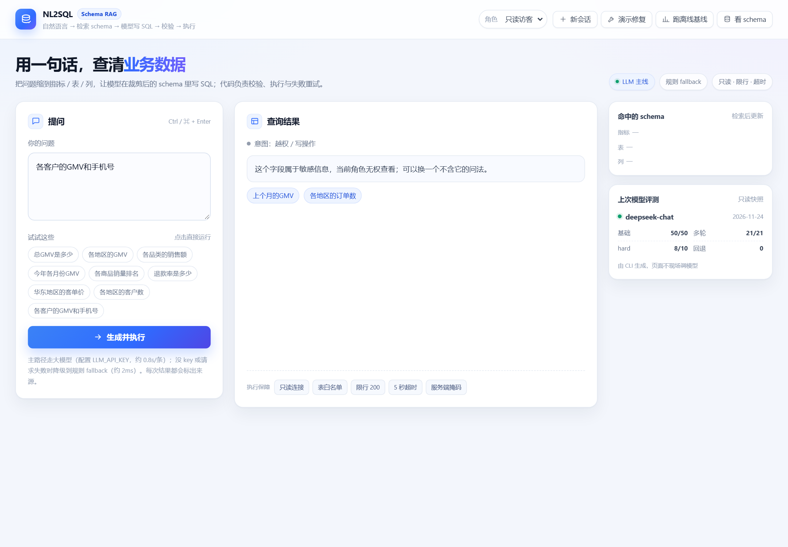
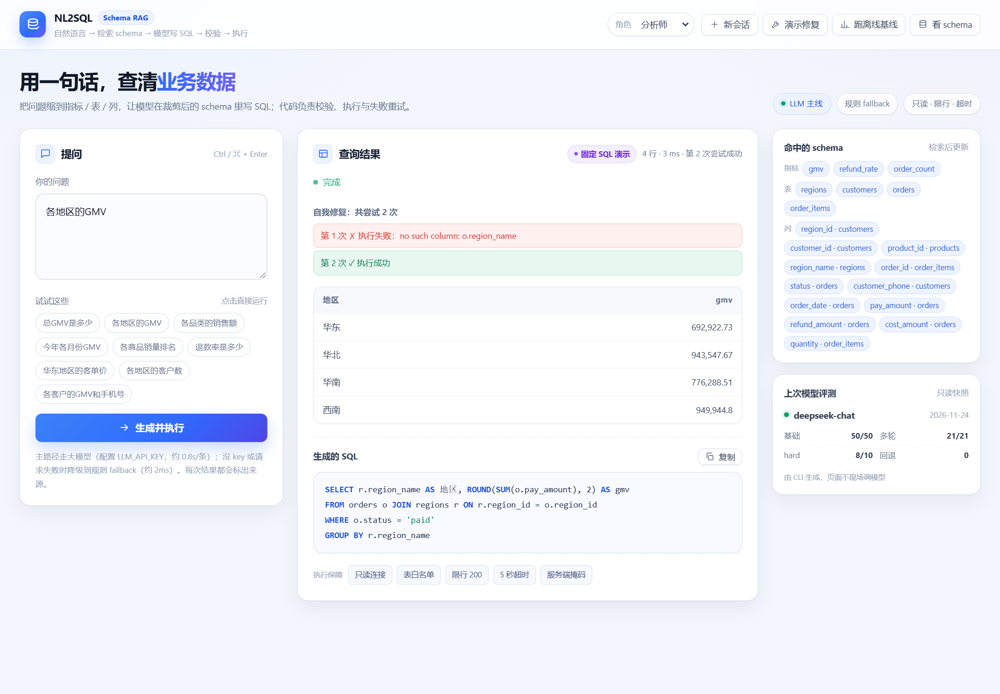

# nl2sql-schema-rag

用自然语言查数据仓库：先把问题映射到「指标 / 表 / 列」，再让模型在缩小的 schema 里写 SQL，最后校验、执行、给出结果。

## 为什么写这个

在宽表几十张、字段几百个的仓库上直接让大模型写 SQL，最常见的问题不是"不会写"，是**编字段**：它会把 `pay_amount` 写成 `pay_amt`，把 `order_date` 当成日期类型去 `DATE()`，或者把两张表的同名字段接错。

所以这个项目的重点不是"接个大模型"，而是**把 schema 缩到模型不会犯错的范围内**：

1. 先从问题里抽出业务词（指标、维度、筛选值、时间）；
2. 用三路检索把候选缩到 3 个指标、12 个列（demo 只有 5 张表、检索最多带 4 张，缩表收益有限）；
3. 只把这部分 DDL 放进 prompt；
4. 生成后用代码校验：只读、单语句、表白名单、限行；字段写错由执行报错兜住，并把报错回传给模型重写。

## 它怎么跑

```
问题 → 角色（裁剪 catalog）→ 会话/槽位继承 → 意图路由 → 槽位（指标/维度/筛选/时间）
     → 三路检索 → 裁剪 DDL → 生成 SQL → 校验（含列白名单）→ 执行 → 服务端掩码 → 结果
     （失败：带报错重写，最多 2 次）
```

- **权限与脱敏**：角色（`analyst` / `viewer`）按请求传；`viewer` 的 catalog 里没有敏感列，生成器拿不到、prompt 里也没有。掩码在服务端结果行上做，`masked_columns` 会告诉前端哪些列被掩过。
- **多轮**：带 `session_id` 时，先从上文补缺失槽位，再判意图。"那上个月呢""换成华南"能接上；换了指标又没指代算新话题。会话只在内存里，默认留 5 轮。
- **意图路由**：五类意图（问数 / 闲聊 / 缺信息 / 超纲 / 越权），规则优先、可解释。只有"问数"会生成 SQL，其余返回话术或澄清项，不会硬编一条 SQL 出来。
- **三路检索**：指标、表、列分别建索引。列用关键词为主（列名要精确命中），指标和表稠密+关键词各占一半，最后 RRF 融合。
- **裁剪**：只渲染命中的表和列，通常 30 行以内；指标把口径描述一起带上。
- **校验**：只允许单条 SELECT、表白名单、禁 DDL/DML、执行时只读连接 + 限行 + 5 秒语句级超时。字段名写错不靠提示词保证，靠数据库报错兜住。
- **自我修复**：失败时把报错拼回 prompt 重写，每次重试都重新过校验器。规则生成器改不了自己的 SQL，所以这条只在配了 `LLM_API_KEY` 时真正生效。
- **兜底**：没配 key 时全走规则（离线可跑），配了走大模型、失败退回规则；返回里的 `engine` 会说明这次是谁生成的。

## 跑起来

本地（零依赖，标准库即可，3.10+）：

```bash
git clone <repo> && cd nl2sql-schema-rag
python scripts/seed_demo_db.py     # 生成演示库 data/demo.sqlite（800 单 / 1608 明细）
python main.py                     # http://127.0.0.1:8000
```

`main.py` 启动时会自动读同目录的 `.env`（没有也能跑）。

Docker（一条命令）：

```bash
docker compose up --build          # http://127.0.0.1:8000
docker compose down
```

镜像基于 `python:3.11-slim`，构建时 seed 演示库；把空目录挂到 `/app/data` 时 entrypoint 会补一次 seed，
自带 `HEALTHCHECK`（打 `/api/health`）。应用本身仍然是零依赖。

Compose 只把 8000 绑到 `127.0.0.1`，避免把无鉴权的 demo / 审计接口暴露到局域网（要局域网演示自己改端口映射）。
要接大模型，照常复制 `.env.example` 为 `.env` 并填 `LLM_API_KEY`：Compose 用宿主 `.env` 做插值、在容器启动时注入，
`.env` 本身已被 `.dockerignore` 排除，不会打进镜像层；也可以 `docker compose run -e LLM_API_KEY=... app`。

想跑评测：

```bash
python -m app.evals                 # 单轮 + 多轮，规则模式（CI 默认）
python -m app.evals --engine llm    # 走真实模型（需要 .env 里的 LLM_API_KEY）
python -m app.evals --multi-turn    # 只跑多轮评测
python -m app.evals --json          # 输出 JSON，CI 用
python -m unittest discover -s tests -v
```

## 开发环境

运行时零依赖，Python >= 3.10 都能跑；仓库本身不绑定解释器，推荐用仓库里的 `.venv`（uv 管理）：

| 场景 | 解释器 |
|---|---|
| PyCharm | `.venv`（uv，Python 3.12.13；`.python-version` 固定 3.12） |
| 命令行 | `.venv/Scripts/python`（Windows）或系统 `python`（3.13 也验证过） |
| CI | 3.11 |

`uv.lock` 已提交，`uv sync --extra dev` 可复现开发环境。`dev` extra 只装 Pillow（给 `scripts/shots.py` 合成 GIF），运行时仍然零依赖。

## 现在的结果

57 条单轮用例（50 条问数 + 7 条意图/越权），**问数执行结果一致率 100%**（50/50）、意图命中 100%（57/57）；另有 7 个会话 × 3 轮的多轮评测，逐轮执行一致率 100%（21/21）；规则模式平均 2ms。159 个单测覆盖检索、生成、校验、修复、路由、多轮、权限、评测和 HTTP 契约。

**真实模型（`deepseek-chat`，2026-11-24，temperature 0，单次运行）**：单轮 **50/50**、多轮 **21/21**、静默回退 **0**、平均约 0.8s/条。规则模式仍是 CI 默认（离线、确定性）；LLM 成绩用 `--engine llm` 手动复现，见「评测与 CI」。

评测集覆盖 6 个指标 × 6 个维度（31/36 组合，customer 维度只留 1 条连通性用例）、6 类时间过滤，以及 chat / 澄清 / 超纲 / 写操作 / 越权 5 类非问数意图。

规则模式的 100% 不能当"模型准确率"看：规则只覆盖了 6 个维度、6 个指标的组合，样本也少；真实模型数字见上面和「已知问题」。

## 页面长什么样

**analyst：手机号在结果行上掩码**（点图看原尺寸）

[](docs/screenshots/01-role-mask-analyst.png)

**viewer：同一句直接判越权，不生成 SQL**

[](docs/screenshots/02-role-mask-viewer.png)

**演示修复：固定 SQL 复现"写错列名 → 带报错改对"（演示，不代表模型能力）**

[](docs/screenshots/03-demo-repair.png)

多轮承接 + "改成华南"（GIF，约 9 秒）：


素材由 `python scripts/shots.py` 用无头 Chrome 固定生成（3 张 PNG + 1 个 GIF）；页面改了重跑一次即可，
不用手工对时间点。脚本是开发工具，只额外需要 Pillow 合成 GIF。

## 自我修复（M1）

生成 → 校验 → 执行，任何一步失败都会把报错拼回 prompt 重写，最多 `max_repair` 次（默认 2）；**每次重试都要重新过校验器**，不会靠"重试"绕过只读检查。

- 返回契约：`ok=true` 时 `error` 为空、`failure_stage` 为空；`ok=false` 时 `error` 是最后一次的报错，`attempts` 记录全部尝试（每次含 `n / sql / ok / error / stage`，`stage` 为 `validate / execute / timeout / ok`）。
- 真实路径：配 `LLM_API_KEY`，模型看到 `no such column: order_cnt` 后改写；
- 可复现演示：`python -m scripts.demo_repair`（脚本化生成器，离线，一条命令看到两次尝试）；
- 超时保护：单条 SQL 超过 5 秒由 sqlite 的 progress handler 中断，记 `执行失败：查询超时（>5 秒），已中断`，并且**不会重试同一句**；
- 页面上会显示"自我修复：共尝试 N 次"和每次的报错；没配 key 时点右上角「演示修复」，走 `/api/demo/repair` 的脚本化生成器，离线也能看到完整的两次尝试。

规则生成器不看 `feedback`，所以**离线模式不会真的改 SQL**——这一点在「已知问题」里写清楚了。

## 多轮追问（M3）

带 `session_id` 才接上文；不带就是单轮，行为与 M2 一致。页面会自动带上，右上角「新会话」可以清空上下文。

顺序是 **会话 → 槽位继承 → 路由 → 生成**，不能反过来：`那上个月呢` 字面上没有指标，先路由会被 M2 判成"需要澄清"，多轮就断在第二轮。所以 `classify(question, catalog, slots)` 只接收算好的槽位，不自己再抽一遍。

继承规则都写在 `app/session.py`，可解释：

| 槽位 | 规则 |
|---|---|
| 指标 | 同一个指标接着说、带指代（那/呢/换成…）、或者只补槽位（"上个月""按品类看下"）才继承；换了指标又没指代、或句子里有新主语（"上个月工资…"）→ 开新话题 |
| 维度 | 没给就继承，给了就覆盖；说"总/整体"且没有"各/按"时，视为显式要求不分组 |
| 筛选 | 按类型覆盖："换成华南"只换地区，上文按品类的筛选还在 |
| 时间 | 没给就继承，给了就覆盖 |

改写后的问句会补一句"（承接上文：GMV、各地区）"，作为生成器的输入，规则和 LLM 看到的是同一个自包含问题；接口也返回 `rewritten_question` 和 `inherited_slots`，页面上会显示这一行。

```bash
# 第一句：拿到 session_id
curl -s localhost:8000/api/ask -d '{"question":"各地区的GMV"}'
# 第二句：带回去就接上文
curl -s localhost:8000/api/ask -d '{"question":"那上个月呢","session_id":"<上一步的 id>"}'
```

会话不落盘（进程内存，重启即清空），每个会话默认留最近 5 轮，会话数也有上限。

## 权限与脱敏（M4）

角色按请求传，不进会话：`{"question": "...", "role": "viewer"}`，页面右上角可以切换。顺序是 **role → 按角色裁剪 catalog → 会话槽位 → 路由 → 检索/生成**——列过滤必须在检索之前，否则隐藏列会进 context 和 prompt。

| 角色 | 敏感列（`customer_phone`） | 普通列 |
|---|---|---|
| `analyst` | 可见，但结果行由服务端掩码成 `138****0047` | 全部可见 |
| `viewer` | 完全不可见：不进 catalog、不进 SQL、不进 prompt、不进错误信息 | 全部可见 |

泄漏路径都堵住了（AC-4.1）：

1. **生成的 SQL**：校验器加了列白名单（`validate(sql, catalog, denied=...)`），命中隐藏列直接拒绝；
2. **`select *`**：`*` 不含列名、白名单匹配不到，所以 `denied` 非空时直接禁止 `select *` 和 `表.*`（`count(*)` 不受影响）；
3. **错误信息**：拒绝话术是"引用了无权访问的列"，不回显列名——否则错误本身就成了泄漏通道；
4. **`attempts[].sql` 与审计**：隐藏列名统一打码成 `***`，前端/日志/审计里都看不到。

请求无权列时返回 `unsafe` + 说明（AC-4.2），不静默把列删掉；掩码只在结果行上做，不写进 SQL（AC-4.3）。掩码列只允许**裸列投影**——改名、函数包裹、拼接都会让结果列名变掉从而绕过按列名的掩码，校验阶段直接拒；结果行上还有一层"11 位手机号"值模式兜底。越权请求和"生成器自己写了隐藏列"都会进审计（AC-4.4）：

```bash
# analyst：返回掩码手机号，masked_columns 里点明
curl -s localhost:8000/api/ask -d '{"question":"各客户的GMV和手机号","role":"analyst"}'
# viewer：同一条问题直接 unsafe
curl -s localhost:8000/api/ask -d '{"question":"各客户的GMV和手机号","role":"viewer"}'
# 审计与按角色裁剪的 schema
curl -s localhost:8000/api/audit
curl -s 'localhost:8000/api/schema?role=viewer'
```

角色策略在 `app/permissions.py`：配"隐藏列 + 掩码列"，敏感列默认隐藏（新加敏感列不配置就不可见，等于最小权限白名单），不是把全部可见列枚举一遍。

## 评测与 CI（M5）

评测分两组，**指标不混算**（混在一起历史数字就不可比了）。

**单轮 57 条**（`eval/cases.json`，50 条问数 + 7 条意图/越权）：主指标是"两边都执行、比对结果集"，SQL 字面匹配只作参考。

| 覆盖 | 现状 |
|---|---|
| 指标 | 6 个指标全部出现 |
| 维度 | 6 个维度全部出现 |
| 指标×维度 | 31/36（customer 维度按客户分组每行 count=1，只留 1 条连通性用例） |
| 时间 | 6 类：上个月 / 本月 / 今年 / 去年 / 最近 30 天 / 指定月份（`month:YYYY-MM`） |
| 意图 | chat ×2 / 超纲 ×2 / clarify ×1 / 写操作 unsafe ×1 / viewer 越权 ×1 |
| 其它 | 地区/品类筛选、双筛选、同义说法（成交额 / 平均订单金额）、Top N |

**多轮 21 轮**（`eval/multi_turn.json`，7 个会话 × 3 轮）：用同一个 `Session` 顺序跑，覆盖时间继承、维度覆盖、筛选切换、"总共"不分组、新话题不继承、澄清轮不污染上下文、**客户维度回环**和**"改成华南"改写**；`multi_turn_rate` 单独统计。

**失败分类**：失败用例带 `failure` 字段，`summary.failure_counts` / `multi_turn_failure_counts` 分别汇总——`routed`（路由拦截）/ `permission`（权限）/ `validate`（校验）/ `field`（字段不存在）/ `syntax`（生成语法错）/ `timeout`（超时）/ `retrieval`（检索未命中）/ `result`（结果不一致）/ `intent`（意图不符）。分类先看 `ask()` 记录的 `attempts[].stage`；只有执行阶段再按错误码区分 `field` / `syntax`（`no such column` / `syntax error`）。

**真实模型模式**（需要 `LLM_API_KEY`）：

```bash
python -m app.evals --engine llm
```

`2026-11-24`、`deepseek-chat`、temperature 0 的单次结果：**单轮 50/50、多轮 21/21、静默回退 0、平均约 0.8s/条**。每条 details 都带 `engine`；`engine=rule` 表示请求失败退回了规则——这种情况 `main()` 直接退出码 1，避免把"LLM 100%"实际上是规则跑出来的成绩当真。CI 默认仍用 rule（离线、确定性），LLM 评测是手动步骤。

阈值：SPEC 门槛 85%，CI 按 90% 卡；意图命中率、多轮一致率同为 90%。CI 跑单测 + 评测（`timeout-minutes: 10`），评测 JSON 作为 artifact 上传，失败时能直接看哪条挂了。

```bash
python -m app.evals --threshold 0.9 --min-intent 0.9 --min-multi 0.9 --json
```

## 配置

不配也能跑。要接大模型，复制 `.env.example` 改名 `.env`（`main.py` 会自己读，不用 `export`）：

| 变量 | 说明 | 默认 |
|---|---|---|
| `LLM_API_KEY` | 为空则走规则生成 | 空 |
| `LLM_BASE_URL` | OpenAI 兼容接口 | `https://api.deepseek.com/v1` |
| `LLM_MODEL` | 模型名 | `deepseek-chat` |
| `PORT` | 服务端口 | 8000 |

数据库、向量库这些没有做成必填：演示库是 SQLite，检索是内存索引。真接 Qdrant/ES 时替换 `app/retrieval.py` 里的 `DenseIndex` 即可。

## 目录

```
app/
  catalog.json      演示 schema（5 表 + 6 指标，customers.customer_phone 标 sensitive）
  catalog.py        加载成领域对象
  domain.py         表/列/指标/命中/计划的定义
  slots.py          业务词槽位（指标/维度/筛选/时间）——全项目唯一的词表
  retrieval.py      三路检索 + RRF
  router.py         意图路由（五类，规则优先；槽位由调用方传入）
  session.py        多轮会话与槽位继承（保留最近 5 轮，进程内存）
  permissions.py    角色策略、catalog 裁剪、掩码、SQL 打码、审计（M4）
  agent.py          生成、校验、执行、自我修复、ask()
  demo.py           离线演示修复用的固定 SQL（M6）
  evals.py          评测（单轮执行一致 / 多轮 / 失败分类）
  env.py            .env 读取（标准库实现）
  server.py         HTTP 服务
  web/              问数页面（原生 JS，无构建）
Dockerfile          容器镜像（python:3.11-slim，构建时 seed）
docker-compose.yml  一条命令启动
uv.lock / .python-version  开发环境锁定（uv，运行不需要）
eval/cases.json     57 条单轮（50 问数 + 7 意图/越权）
eval/multi_turn.json 7 个会话 × 3 轮多轮对照
scripts/seed_demo_db.py
scripts/demo_repair.py  演示"写错列名 → 带报错改对"
scripts/shots.py    固定截图脚本（无头 Chrome + GIF）
docs/screenshots/   3 张截图 + 多轮 GIF
tests/              159 个单测（含 HTTP 契约）
docs/decisions.md   几个取舍的记录
```

## 已知问题

- **只支持单指标 + 单维度**。「各品牌客单价和销量对比」这种会退化成默认维度，代码里留了 FIXME。
- **规则生成覆盖窄**：时间只认上个月/本月/今年/去年/最近 30 天/具体月份，其它说法会忽略。
- **自我修复在离线模式下是空转**：规则生成器不看 `feedback`，同一句 SQL 会重复生成；页面的「演示修复」和 `scripts/demo_repair.py` 用脚本化生成器复现"写错列名 → 改对"，真实修复要配 `LLM_API_KEY`。
- **演示修复端点只用于展示**：`/api/demo/repair` 固定两条 SQL、不写会话、不参与评测；它证明的是时间线和重试链路，不代表模型能力。
- **Compose 是单机 demo**：没有 TLS、认证、持久卷策略；真要部署，先补这几样再谈生产。
- **路由是规则 + 词表**：换个说法仍可能误判；已知反例都写进了 `tests/test_router.py`，也还没接 LLM 兜底。
- **多轮靠规则继承**：只认槽位、指代词（那/呢/换成…）和"纯槽位"的补充（"上个月""按品类看下"）；句子里有新主语就要求澄清（"上个月工资发了多少"），也没有跨会话记忆。
- **会话不落盘**：进程内存，重启即清空；每会话 5 轮、最多 200 个会话，超了淘汰最旧的；`session_id` 仍完全信任客户端（没有 TTL，知道 id 就能接进别人会话）。
- **权限是"隐藏/掩码列"配置**，不是逐列枚举的白名单：敏感列默认隐藏，普通列两个角色都可见；新增普通列不需要改配置，新增敏感列忘了配置也不会泄漏。
- **审计在进程内**（环形缓冲 100 条），重启即清空，也没有鉴权入口——demo 只做到可观测。role 同样由客户端声明（`{"role": "analyst"}`），没有认证：这是权限**策略**演示，不是账号体系。
- **demo 只有 5 张表**：检索最多带 4 张，缩表的收敛收益仍然有限，真正收敛的是列（24 → 12）和指标（6 → 3）。
- **列检索的稠密部分是近似**（字符 n-gram 哈希），换成真 embedding 后指标会变，现在的成绩不可直接对比。
- **评测集 57 条仍是自己写的**：覆盖 6 指标 × 6 维度（31/36）、多轮 7 个会话 21 轮，有过拟合的嫌疑；真实模型 50/50 是单次采样，下一步要拿真实提问继续补。
- **LLM 评测是单次采样**：`deepseek-chat` 在 temperature 0 下仍偶有波动（出现过 49/50）；复现建议连跑 2~3 次取均值，换模型或改 prompt 后要重跑。
- **模型效果依赖上下文质量**：这次把 JOIN 键、表关系、指标过滤规则补进 prompt 后，同一模型从 68% 到 100%；换 schema 或指标口径时要同步维护 `catalog.json` 的 relations 和 prompt 规则。

## 下一步

- [x] 多轮追问与指代消解（先槽位继承，再路由）
- [x] 列级权限与脱敏（不同角色看不到的字段要过滤，且不进 prompt/结果）
- [x] 评测补到 50 条 + CI 门禁 + 失败分类（检索未命中 / 语法错 / 字段不存在 / 结果不一致）+ 多轮评测
- [x] Docker Compose、截图与 GIF
- [ ] 接 Qdrant + ES，把内存索引换掉

## License

MIT
